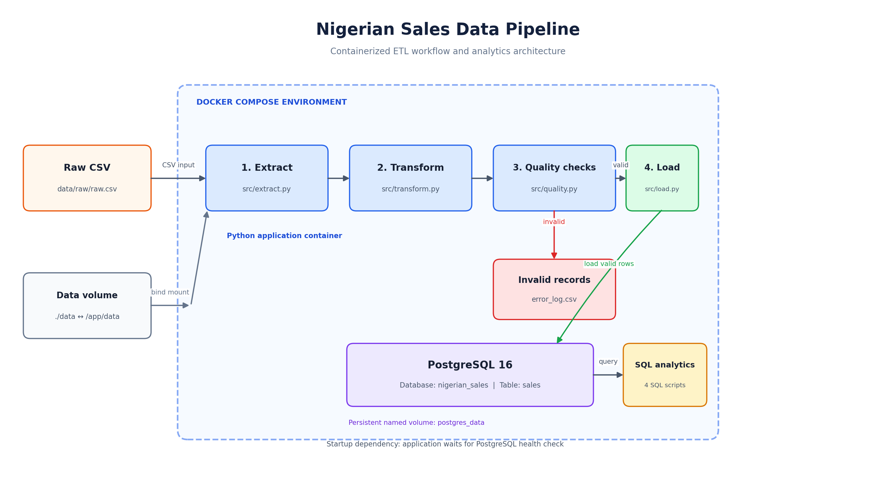

# Nigerian Sales Data Pipeline

A containerized ETL pipeline that extracts Nigerian sales records from a CSV file, transforms and validates the data with Python, and loads valid records into PostgreSQL for SQL-based analysis.

The project demonstrates a practical data engineering workflow, including data extraction, cleaning and transformation, data quality checks, relational database loading, automated testing, Docker containerization, and analytical SQL queries.

## Project Overview

The pipeline processes a raw Nigerian sales dataset and loads the validated records into a PostgreSQL database.

In the current run:

| Pipeline metric | Result |
|---|---:|
| Raw records extracted | 550 |
| Records after transformation | 471 |
| Valid records | 471 |
| Invalid records | 0 |
| Records loaded into PostgreSQL | 471 |

These figures describe the current dataset and execution; results may differ if the source data changes.

## Architecture

The workflow is:

1. **Extract** — read the source CSV file.
2. **Transform** — standardize text fields, handle missing values, convert dates, derive year and month, and prepare the sales fields.
3. **Validate** — apply data quality rules and separate invalid records.
4. **Load** — insert valid records into PostgreSQL.
5. **Analyze** — run SQL queries to examine sales, products, locations, and customers.



## Technology Stack

- **Python 3.12** — pipeline implementation.
- **Pandas** — data extraction and transformation.
- **SQLAlchemy** — database connectivity and loading.
- **PostgreSQL 16** — relational database.
- **psycopg2** — PostgreSQL driver.
- **pytest** — automated tests.
- **Docker** — application containerization.
- **Docker Compose** — orchestration of the application and database containers.
- **SQL** — sales analysis.

## Project Structure

```text
nigerian-sales-data-pipeline/
│
├── data/
│   ├── raw/
│   │   └── raw.csv
│   └── processed/
│
├── src/
│   ├── extract.py
│   ├── transform.py
│   ├── quality.py
│   ├── load.py
│   └── pipeline.py
│
├── tests/
│   ├── test_extract.py
│   ├── test_transform.py
│   ├── test_quality.py
│   ├── test_load.py
│   └── test_pipeline.py
│
├── sql/
│   ├── 01_sales_overview.sql
│   ├── 02_product_analysis.sql
│   ├── 03_location_analysis.sql
│   └── 04_customer_analysis.sql
│
├── docs/
│   └── architecture.png
│
├── .dockerignore
├── .env.example
├── .gitignore
├── Dockerfile
├── docker-compose.yml
├── requirements.txt
└── README.md
```

## Dataset

The source file is expected at:

```text
data/raw/raw.csv
```

The dataset contains these fields:

- `Customer Name`
- `State`
- `Product`
- `Units Sold`
- `Unit Price`
- `Total Sale`
- `Sale Date`
- `Sales Channel`
- `Order ID`

The pipeline transforms the source fields and derives `Year` and `Month` from `Sale Date` for analysis.

## Data Transformation

The transformation stage prepares the source records for validation and loading. It includes:

- Trimming whitespace and standardizing product, state, and sales-channel text.
- Removing records without a customer name or order ID.
- Assigning `Unknown` to missing sales-channel values.
- Converting the sales channel to a categorical data type.
- Parsing sale dates as datetime values.
- Handling missing unit prices using the median unit price for the corresponding product.
- Calculating missing units sold or total sale where the other required values are available.
- Applying the selected product-level mode fallback for missing units sold, with an overall mode fallback.
- Creating flags to identify records where price or volume values were imputed.
- Deriving `Year` and `Month` from the sale date.

## Data Quality Checks

The quality module evaluates each transformed record against these rules:

| Check | Rule |
|---|---|
| Order ID present | Order ID must not be null. |
| Order ID unique | Order ID must not be duplicated. |
| Quantity positive | Units sold must be greater than zero. |
| Unit price non-negative | Unit price must be greater than or equal to zero. |
| Valid sale date | Sale date must parse successfully and must not be in the future. |
| Valid state | State must match a recognized Nigerian state or Abuja. |
| Revenue non-negative | Total sale must be greater than or equal to zero. |

Records that pass all checks are sent to the loading stage. Records that fail are excluded from the load and written to `error_log.csv` for review when invalid records are present.

## Database

The pipeline loads data into PostgreSQL using the `sales` table.

The loader maps the source column names to database-friendly names, validates that required columns are present, and checks that order IDs are not null or duplicated before insertion.

When the pipeline runs with `replace=True`, it clears an existing `sales` table before loading the current valid dataset. If the table does not yet exist, the loader skips the clearing step and creates the table through Pandas `to_sql()`.

### Database configuration

Create a local `.env` file in the project root. Use `.env.example` as a template:

```env
DB_HOST=localhost
DB_PORT=5432
DB_NAME=nigerian_sales
DB_USER=ojay
DB_PASSWORD=your_password
```

Do not commit `.env` or real database credentials to version control.

## Running the Project Locally

### 1. Clone the repository

```bash
git clone <your-repository-url>
cd nigerian-sales-data-pipeline
```

### 2. Create and activate a virtual environment

```bash
python3 -m venv .venv
source .venv/bin/activate
```

On Windows PowerShell, activate it with:

```powershell
.venv\Scripts\Activate.ps1
```

### 3. Install dependencies

```bash
pip install -r requirements.txt
```

### 4. Configure the environment

Create `.env` in the project root and provide the connection details for your local PostgreSQL instance.

### 5. Run the pipeline

Ensure PostgreSQL is running and the configured database exists. Then run:

```bash
python -m src.pipeline
```

## Running with Docker Compose

Docker Desktop with the WSL 2 engine and WSL integration, or another working Docker Engine with the Compose plugin, is required.

### 1. Configure environment variables

Create `.env` in the project root using `.env.example` as a template. Set a strong database password.

The Compose configuration uses the `db` service name as the application's database host. The database is exposed on host port `5433`, while it listens on port `5432` inside the Docker network.

### 2. Build and start the services

```bash
docker compose up --build
```

Compose starts the PostgreSQL service, waits for its health check to pass, and then runs the pipeline application.

The application container exits with code `0` when the pipeline completes successfully. The database container remains available.

### 3. Verify the loaded records

Open a PostgreSQL prompt inside the database container:

```bash
docker compose exec db psql -U ojay -d nigerian_sales
```

Run:

```sql
SELECT
    COUNT(*) AS total_records,
    COUNT(DISTINCT order_id) AS unique_orders,
    SUM(total_sale) AS total_revenue
FROM sales;
```

Exit the PostgreSQL prompt:

```sql
\q
```

### 4. Useful Docker commands

View service status:

```bash
docker compose ps -a
```

View application logs:

```bash
docker compose logs app
```

View database logs:

```bash
docker compose logs db
```

Stop the services:

```bash
docker compose down
```

The named PostgreSQL volume preserves database data when containers are stopped or removed. To remove the containers **and permanently delete the persisted database volume**, use:

```bash
docker compose down -v
```

Use the last command only when you intentionally want to delete the Docker database and its stored data.

## Running the Tests

The project includes tests for extraction, transformation, data quality, loading, and pipeline orchestration.

With the virtual environment activated and dependencies installed, run:

```bash
pytest -v
```

The test suite has passed **45 tests** in the development environment.

## SQL Analysis

The `sql/` directory contains four analytical SQL scripts:

| File | Analysis |
|---|---|
| `01_sales_overview.sql` | Overall sales performance, monthly trends, sales channels, date range, and data completeness. |
| `02_product_analysis.sql` | Product performance, units sold, average prices, and revenue contribution. |
| `03_location_analysis.sql` | Sales performance by state and product/location breakdowns. |
| `04_customer_analysis.sql` | Customer spending, order frequency, channel and state activity, and repeat purchasing. |

These scripts are intended to be run against the loaded `sales` table.

## Key Learning Outcomes

This project provided practical experience with:

- Building a modular Python ETL pipeline.
- Cleaning and transforming tabular data with Pandas.
- Implementing record-level data quality checks.
- Loading data into PostgreSQL with SQLAlchemy.
- Writing SQL queries for business analysis.
- Writing automated tests with pytest.
- Containerizing a Python application.
- Running and connecting multiple services with Docker Compose.
- Managing configuration through environment variables.

## Future Improvements

Potential next improvements include:

- Orchestrating scheduled pipeline runs with Apache Airflow.
- Introducing dbt for modular SQL transformations and data testing.
- Adding structured logging and pipeline run metadata.
- Implementing incremental loading instead of full-table replacement.
- Adding CI automation to run tests on each repository update.

## Author

**Sunday Philip Ojogbane**

Mechatronics Engineering graduate building practical skills in data engineering, Python, SQL, ETL development, and data pipeline automation.

[LinkedIn](<your-linkedin-url>) · [GitHub](<your-github-url>)
